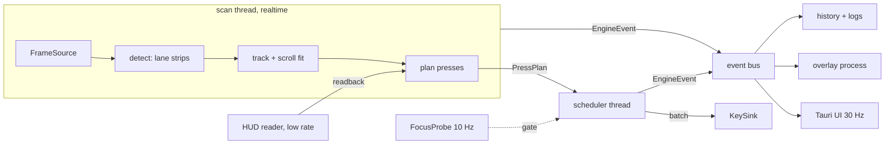

# Architecture

Full detail lives in [docs/specs/](docs/specs/00-index.md). This page is the map.

## Crates (Cargo workspace)

| Crate | Kind | Owns | OS deps |
|---|---|---|---|
| `arrowhead-core` | lib | Frame types, detection, tracking, timing, scheduler, player model, session state machine, config types, runtime (threads over traits), platform scheduling shim | `libc` / `windows` only in `runtime::platform` |
| `arrowhead-capture` | lib | `FrameSource` backends: PipeWire (Linux), DXGI + WGC (Windows), clip replay, clip recorder | ashpd, pipewire, windows-capture |
| `arrowhead-input` | lib | `KeySink` backends (uinput, SendInput, null), `FocusProbe` backends, global hotkeys | evdev, zbus, windows |
| `arrowhead-runner` | lib | The live run shared by app and CLI: calibrate, scan/scheduler threads, hotkeys, focus, latency test, permission checks; reports `EngineEvent`s | via input |
| `arrowhead-app` | bin | Tauri 2 shell, commands, event bridge to the React UI in `ui/` | tauri |
| `arrowhead-overlay` | bin | Click-through overlay process (layer-shell on Wayland, layered window on Windows) | sctk, tiny-skia, windows |
| `arrowhead-cli` | bin | Headless run, record, replay, detect, bench, diagnostics | none beyond the libs |

## Data flow

## Threads

| Thread | Priority | Does |
|---|---|---|
| capture | backend-owned (PipeWire loop / DXGI acquire) | Delivers cropped frames into a 3-slot ring |
| scan | realtime (SCHED_FIFO if allowed, else nice -10; Windows HIGH) | Detect, track, plan. Never blocks on I/O |
| scheduler | realtime | Sleeps to the exact press time (absolute sleep + short spin), sends batches |
| hud | normal | Reads ms popup, accuracy, scores at 10-20 Hz from the same frames |
| focus | normal | Polls the focused window at 10 Hz, publishes an atomic bool |
| bus | normal | Fans events out to UI, overlay, history, logs |

## Hard rules
- `arrowhead-core` never touches a real screen or keyboard. Tests drive it with `ReplaySource`, `SyntheticSource`, `RecordingSink` and a virtual `Clock`.
- Every key press has a matching release, enforced by the scheduler, a watchdog and drop/panic/signal hooks.
- All timestamps are monotonic nanoseconds (`Nanos(u64)`), taken from the capture backend's presentation time where available.
