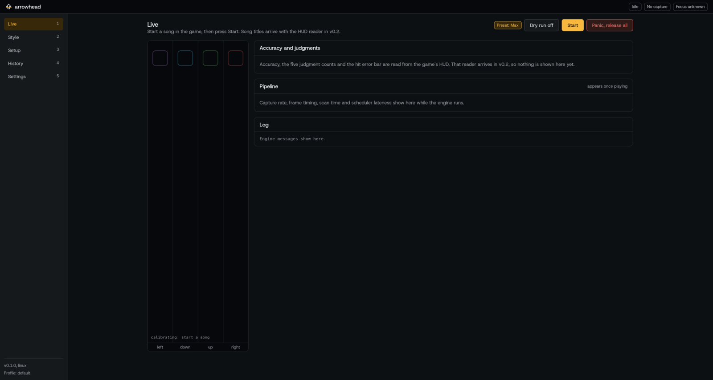
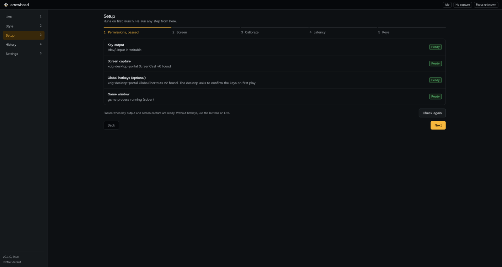
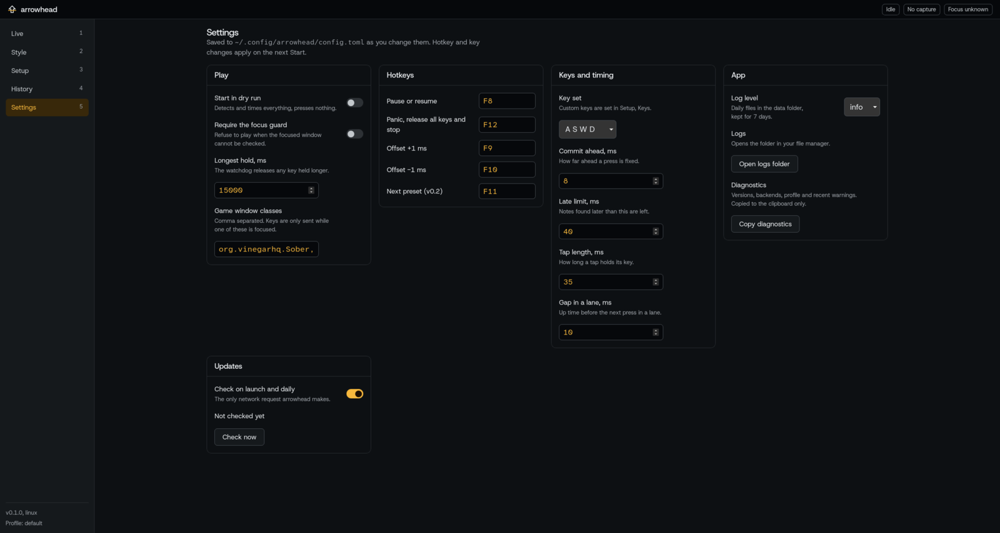

<p align="center"></p>

<h1 align="center">arrowhead</h1>

<p align="center">A screen-reading Funky Friday autoplayer for Linux, for private servers with friends.</p>

<p align="center">
  <a href="https://github.com/TheGeneral4757/arrowhead/releases/latest"></a>
  <a href="https://github.com/TheGeneral4757/arrowhead/actions/workflows/ci.yml"></a>
  <a href="LICENSE"></a>
  
</p>

<p align="center"></p>

arrowhead reads the four lanes off your screen, predicts when each note crosses the receptor and presses the key on time. v0.1 plays the **Max** preset (every note centred); a player model that plays like a person at the accuracy you pick comes in v0.2. 4 keys only. Rust + Tauri, by James Thiessen. Successor to fnf-thing-v2.

> [!WARNING]
> Automating input in Roblox breaks its Terms of Use and can get an account banned. arrowhead is for private servers with people who know. You carry the risk.

## Features

- **Reads the screen, nothing else.** PipeWire screen capture through xdg-desktop-portal. No game memory, no injection.
- **Learns your setup.** Lane colours, scroll direction, side and scroll speed are detected from your screen, not hard-coded.
- **On time.** Notes are tracked across frames and pressed at the predicted crossing, with latency calibration.
- **Safe by default.** Focus guard, stuck-key watchdog, release-all on exit or crash, a panic hotkey and a dry-run mode.
- **App and CLI.** A desktop app (Live, Setup, Settings) and `arrowhead-cli` for capture, replay and diagnostics.
- **Private.** No telemetry. The only network call is the update check, which you can turn off.

| Setup | Settings |
|---|---|
|  |  |

## Install

**Arch (AUR):** `arrowhead-bin` (coming soon). Updates come from your package manager.

```sh
yay -S arrowhead-bin
```

**Any distro (tarball):** grab `arrowhead-X.Y.Z-linux-x86_64.tar.gz` and `SHA256SUMS` from the [latest release](https://github.com/TheGeneral4757/arrowhead/releases/latest), then:

```sh
sha256sum -c --ignore-missing SHA256SUMS
tar xzf arrowhead-*-linux-x86_64.tar.gz
cd arrowhead-*-linux-x86_64 && ./arrowhead
```

The tarball install updates itself from inside the app (signed with the release's `.sig`).

**Needs:** webkit2gtk-4.1, libsoup3, gtk3, pipewire, xdg-desktop-portal plus a backend (`xdg-desktop-portal-kde` or `xdg-desktop-portal-hyprland`), and a writable `/dev/uinput` for key output.

## First run

1. Start Funky Friday in Sober (`org.vinegarhq.Sober`) on a private server.
2. Open arrowhead and go to **Setup**: Permissions, Screen, Calibrate, Latency, Keys.
3. On **Live**, start a song in the game, then press **Start**. Turn on **Dry run** first if you want to watch without pressing keys.

Default hotkeys: F8 pause, F12 panic (release all and stop), F9 / F10 nudge the offset by 1 ms.

## Platforms

| OS | Status | Notes |
|---|---|---|
| Linux (KDE Plasma 6, Hyprland) | v0.1 | Game via Sober. Needs PipeWire and a writable `/dev/uinput`. |
| Windows 10/11 | v0.2 | Built in CI. Whether Roblox's anti-cheat tolerates synthetic input is unknown. |

<details>
<summary><b>Roadmap: v0.1 vs v0.2</b></summary>

| Area | v0.1 (Linux) | v0.2 |
|---|---|---|
| Capture | xdg-desktop-portal ScreenCast over PipeWire | + Windows DXGI, Graphics Capture fallback |
| Detection | Lane strips above each receptor, learned colours, holds, up/downscroll, side detection | + HUD reading (accuracy, opponent score) |
| Timing | Note tracking, fitted scroll speed, press at predicted crossing, latency auto-calibration | + ms-popup readback self-correction |
| Play style | Max (every note centred) | Player model + target-accuracy controller, presets, match-my-friend |
| Input | uinput virtual keyboard | + Windows SendInput scan codes |
| Safety | Focus guard, stuck-key watchdog, release-all on exit/crash, panic hotkey, dry run | same |
| UI | Tauri 2 app: Live, Setup, Settings | + Style, History, click-through overlay |

Full plan: [docs/specs/11-roadmap.md](docs/specs/11-roadmap.md).
</details>

<details>
<summary><b>Docs</b></summary>

| Doc | What |
|---|---|
| [docs/vision/VISION.md](docs/vision/VISION.md) | What arrowhead is and should be |
| [docs/vision/decisions.md](docs/vision/decisions.md) | Decision log from planning (2026-11-21) |
| [docs/vision/design-review.html](docs/vision/design-review.html) | Clickable UI prototype, stack and logo review |
| [docs/specs/](docs/specs/00-index.md) | Detailed specs, one per subsystem |
| [docs/research/](docs/research/) | Research notes: APIs, game mechanics, screenshots, prior art |
| [ARCHITECTURE.md](ARCHITECTURE.md) | Crates, threads, data flow |
| [CONTRIBUTING.md](CONTRIBUTING.md) | Workflow, commits, tests |
</details>

## AI use

arrowhead is made by **James Thiessen**. The entire codebase (code, specs, docs, UI and CI) was generated with AI, using Claude Code with Anthropic's Claude Opus 5.5, directed and tested by James. Commits carry a `Co-Authored-By: Claude` trailer. Review it with that in mind.

## License

MIT, Copyright (c) 2026 James Thiessen. See [LICENSE](LICENSE).
