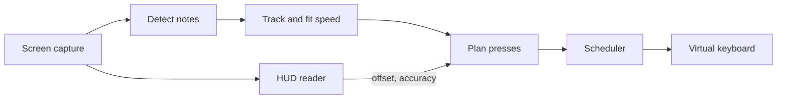

# arrowhead user guide

Everything about installing, setting up and using arrowhead, and how it works inside. The [README](../README.md) has the short version.

> [!WARNING]
> Automating input in Roblox breaks its Terms of Use and can get an account banned. Use arrowhead on private servers with people who know, at your own risk.

- [1. Install](#1-install)
- [2. One-time system setup (Linux)](#2-one-time-system-setup-linux)
- [3. First run: the Setup page](#3-first-run-the-setup-page)
- [4. Playing a song](#4-playing-a-song)
- [5. Styles and match my friend](#5-styles-and-match-my-friend)
- [6. History](#6-history)
- [7. Settings](#7-settings)
- [8. How it works](#8-how-it-works)
- [9. Files it keeps](#9-files-it-keeps)
- [10. Troubleshooting](#10-troubleshooting)
- [11. Updating and removing](#11-updating-and-removing)

## 1. Install

Pick one. All builds are on the [releases page](https://github.com/TheGeneral4757/arrowhead/releases/latest).

| Option | For | Updates |
|---|---|---|
| AppImage (`arrowhead-X.Y.Z-linux-x86_64.AppImage`) | Any Linux distro, one file | In the app: Settings, "Update and restart" |
| Tarball (`arrowhead-X.Y.Z-linux-x86_64.tar.gz`) | Any Linux distro, unpacked folder | The app tells you; download the new one |
| AUR (`arrowhead-bin`, coming soon) | Arch and derivatives | Your package manager |
| Windows MSI or zip | Windows 10/11 (not yet tested on real hardware) | MSI: in the app. Zip: download the new one |

**AppImage**

```sh
chmod +x arrowhead-0.2.0-linux-x86_64.AppImage   # the version you downloaded
./arrowhead-0.2.0-linux-x86_64.AppImage
```

It needs `libfuse2` (most distros have it; on Arch: `sudo pacman -S fuse2`) and a 2024 or newer distro (glibc 2.39: Ubuntu 24.04, Fedora 40, Debian 13, Arch or newer). It carries its own WebKit, so it does not need webkit2gtk installed.

**Tarball**

```sh
sha256sum -c --ignore-missing SHA256SUMS
tar xzf arrowhead-*-linux-x86_64.tar.gz
cd arrowhead-*-linux-x86_64 && ./arrowhead
```

The tarball uses your system's libraries: webkit2gtk-4.1, libsoup3, gtk3.

**Arch:** `yay -S arrowhead-bin` (or `paru -S arrowhead-bin`), coming soon: the package is not on the AUR yet.

Every Linux install also needs PipeWire and xdg-desktop-portal with the backend for your desktop: `xdg-desktop-portal-kde` on KDE Plasma, `xdg-desktop-portal-hyprland` on Hyprland. Most desktops already have these.

## 2. One-time system setup (Linux)

### Let arrowhead press keys (`/dev/uinput`)

arrowhead presses keys through a virtual keyboard (`/dev/uinput`), so the game sees ordinary key presses. Your user needs write access to it. Without it the app still runs, but only in dry run (nothing pressed).

Check:

```sh
test -w /dev/uinput && echo ok || echo "not writable"
```

If it is not writable, give the logged-in user access with a udev rule, then log out and back in:

```sh
echo 'KERNEL=="uinput", SUBSYSTEM=="misc", TAG+="uaccess", OPTIONS+="static_node=uinput"' | sudo tee /etc/udev/rules.d/60-arrowhead-uinput.rules
echo uinput | sudo tee /etc/modules-load.d/uinput.conf
sudo modprobe uinput
sudo udevadm control --reload && sudo udevadm trigger
```

`uaccess` gives access only to the user sitting at the machine, not to every program on the system.

### The game

Run Roblox through [Sober](https://sober.vinegarhq.org/) (`org.vinegarhq.Sober`), join Funky Friday on a private server, and use the 4-key mode. Note the four keys you play with in Funky Friday's keybind settings: arrowhead must press the same ones.

Known Sober issue on KDE: the game can drop to about 16 fps while focused (Sober issue #2027). arrowhead copes with low frame rates, but the game itself plays worse.

### Hotkeys

The app asks the desktop for global shortcuts (the GlobalShortcuts portal). KDE shows a dialog the first time: accept it. If the portal is missing, arrowhead reads keyboards directly, which needs your user in the `input` group (`sudo usermod -aG input $USER`, then log in again). Hotkeys are optional: the app's buttons do the same.

## 3. First run: the Setup page

Start the game first and keep it on screen. Then open arrowhead and go to **Setup**. Each step can be run again at any time.

1. **Permissions.** Checks key output (`/dev/uinput`), hotkeys, screen capture (the portal) and whether the game is running. Key output and screen capture must pass; fix them with [section 2](#2-one-time-system-setup-linux).
2. **Screen.** Opens your desktop's screen picker. Choose the **monitor the game is on** (a whole monitor, not a window). The picker shows only the first time: arrowhead keeps a restore token, so later starts reuse your choice without asking.
3. **Calibrate.** Start any song in the game. arrowhead finds your four receptors, which side of the screen is yours, the scroll direction and the note colours, and shows a snapshot with what it found. If the boxes are a little off, drag to nudge them, or press Re-detect. The result is saved to your profile, so you do this once per monitor and skin.
4. **Latency.** A short key test that measures your input delay. It is a reference value: the timing offset arrowhead plays with is tuned from the game itself while you play (see [Timing](#timing)).
5. **Keys.** Pick the key set that matches your Funky Friday keybinds (WASD, arrows, or custom), then test each lane during a song.

## 4. Playing a song

1. In the game, pick a song (you can be on the song menu or already in the countdown).
2. In arrowhead, open **Live** and press **Start**. Turn on **Dry run** first if you want to watch what it would press without pressing anything.
3. The state shows **Searching** (finding the playfield), **Armed** (ready, waiting for notes), **Playing**, and back to **Armed** between songs. One Start covers as many songs as you like; press **Stop** when done.

What Live shows while playing:

- the game's accuracy (read from your screen) and the target, if a style has one,
- the five judgment counts, hit errors of the last 40 notes, unstable rate and the current timing offset,
- the song name, and both scores when match my friend is on,
- "What it sees": which parts of the game's HUD it has found and its last reads.

**Hotkeys** (defaults; change them under `[hotkeys]` in `config.toml`):

| Key | Does |
|---|---|
| F8 | Pause / resume |
| F12 | Panic: release every key and stop |
| F9 / F10 | Max: move the offset 1 ms later / earlier. Styles: target +0.5 / -0.5% |

**Overlay.** A small click-through panel over the game with the state, the last judgment and the hit errors. It places itself where it covers neither the lanes nor the HUD (arrowhead reads what is under it). By default (Auto) it shows only when you have one monitor. Show or hide it from Live or Settings at any time; the run goes on.

**Safety.** Where arrowhead can check focus (KDE, Windows), keys are only pressed while the game window has focus: alt-tab away and everything is released. Where it cannot (Hyprland for now), it plays and warns, unless "Require the focus guard" is on in Settings, which then refuses to play. A watchdog releases any key held too long, and every key is released when arrowhead stops, crashes or is killed.

## 5. Styles and match my friend

The **Style** page picks how arrowhead plays:

- **Max** presses every note centred. Use it to test timing.
- **Presets** play like a person: small timing errors, the odd Good or Ok, a target accuracy that a controller keeps the game's real accuracy near. Pick one, move the target, or open the advanced drawer and save your own.
- **Match my friend** (not for Max): reads both scores and keeps yours a set margin (-3 to +3%) from your friend's. Your side of the screen is found automatically; set it in Settings ("Your side") if it guesses wrong.

The page shows a model estimate of what a style will score. It is an estimate: the game's accuracy formula is not fully known.

## 6. History

Every song gets a row: song name and difficulty, style and target, accuracy, the five counts, mean error, unstable rate, a hit-error histogram, and the offset used. After a song arrowhead waits up to 20 s for the results screen and takes its exact numbers (total notes, highest combo), checked against the score; otherwise the row keeps the last live reading.

## 7. Settings

| Setting | What it does |
|---|---|
| Key set | WASD, arrows or custom: must match your Funky Friday keybinds |
| Your side | Auto, left or right: which score and stats are yours |
| Start in dry run | Every Start begins with Dry run on |
| Require the focus guard | Refuse to play when the game window's focus cannot be checked (otherwise it plays and warns) |
| Game window classes | Which windows count as the game for the focus guard |
| Longest hold, ms | Safety limit: a key is never held longer than this |
| Read the game's HUD | The HUD reader: readback, accuracy, History numbers, style feedback |
| Overlay over the game, Overlay monitor | Auto / On / Off, and which output it goes on |
| Check on launch and daily | The update check |
| Log level, Logs | How much goes into the daily log; open the log folder |
| Diagnostics | "Copy diagnostics": a text summary to paste into a bug report |

Less common options live in `~/.config/arrowhead/config.toml` (see [section 9](#9-files-it-keeps)): the hotkeys (`[hotkeys]`), minimising the window while playing (`[ui] minimise_while_playing`, Auto: only with one monitor and the overlay up), the profile (`profile`), and `[debug] flight_recorder = true`, which saves the last 10 s of frames and presses whenever a note is missed, for bug reports.

## 8. How it works

arrowhead only looks at the screen and presses keys. It never reads or changes the game's memory.



### Capture
The desktop's screen-capture portal streams the game's monitor over PipeWire at its full refresh rate (Windows: DXGI Desktop Duplication or Windows Graphics Capture). Only a strip around your four lanes is processed every frame; small side copies of the HUD (stats panel, judgment counts, your ms readout, scores, song title) go to a separate thread about 20 times a second.

### Detection
Calibration learns, from your own screen, where the receptors are, which side is yours, the scroll direction, each lane's note colour and the hold-trail colour. Each frame, every lane's strip is scanned for runs of that note colour (heads) and of the trail colour against the learned stage background (holds). Nothing about positions, sizes or colours is hard-coded.

### Tracking and timing
Heads are followed from frame to frame. The scroll speed is fitted from many note pairs and refitted when the song changes speed. Each note's crossing time is predicted from its fitted path, and a press is committed a few ms before it is due, then held to the end of a hold or released quickly for a tap. Frames the game shows twice are skipped, so the tracker never mistakes a repeated frame for notes stopping.

### Timing offset and readback
<a id="timing"></a>The game shows how early or late each hit was (the ms popup) and keeps a Mean MS on its stats panel. arrowhead reads both, matches each popup to the press that caused it, and moves its timing offset toward zero error. It only learns from popups the stats panel confirms, divides by the song rate at speeds other than 1.00x, and saves at most 1 ms of change per song (from the results screen's whole-song mean when it can be read). Per-lane and per-pattern (chords, jacks) corrections start after 20 samples each.

### HUD reader
The game's fonts are learned on the fly: an OCR model (bundled, runs locally) reads the panels at first, and its readings teach a fast glyph matcher that then reads every tick. Every reading is checked against the game's own arithmetic (Hits = Sick + Good + Ok + Bad, the two Miss counters agree, the results score = 350 Sick + 200 Good + 100 Ok + 50 Bad - 30 Miss), and anything that does not add up is thrown away and relearned.

### Styles
A player model draws a timing error for each note from the style's spread, with more error on chords, jacks and fast streams, and decides the odd miss. A controller compares the game's accuracy with the target and turns the spread up or down.

### Input and safety
Presses go to a high-priority scheduler thread that sends them through a uinput virtual keyboard (Windows: SendInput) at the planned time, typically within a fraction of a millisecond. Every press has a release; keys are released on focus loss, pause, panic, a watchdog timeout, exit, crash or kill.

### Privacy
No telemetry. The only network request is the update check, which can be turned off. OCR runs on your machine.

## 9. Files it keeps

| Path | What |
|---|---|
| `~/.config/arrowhead/config.toml` | Settings |
| `~/.config/arrowhead/profiles/<name>.toml` | Layout, colours, HUD regions, timing offset |
| `~/.local/share/arrowhead/history.jsonl` | History rows |
| `~/.local/share/arrowhead/songs.json` | Per-song memory (offset, corrections, last accuracy) |
| `~/.local/share/arrowhead/glyphs/` | The learned HUD fonts |
| `~/.local/share/arrowhead/logs/` | Daily logs, kept 7 days |
| `~/.local/share/arrowhead/flight/` | Flight recorder dumps (when turned on) |

On Windows: settings and profiles under `%APPDATA%\arrowhead`, the rest under `%LOCALAPPDATA%\arrowhead`.

## 10. Troubleshooting

| Problem | Try |
|---|---|
| "dry run only" / keys not pressed | `/dev/uinput` is not writable: [section 2](#let-arrowhead-press-keys-devuinput). Check Dry run is off and the game window has focus |
| Screen picker every start, or no picture | Install the portal backend for your desktop; pick the whole monitor in Setup, Screen |
| Receptors in the wrong place | Setup, Calibrate: nudge or Re-detect. After changing monitor, resolution or skin, calibrate again |
| Notes missed at a steady rate | Check the game runs smoothly (Sober issue #2027 on KDE); turn the overlay off to compare; turn on the flight recorder and send the dump |
| Timing a bit early or late | Play a few songs with the HUD reader on: the offset tunes itself. Max: F9 / F10 by 1 ms |
| Accuracy or History numbers missing | The HUD reader needs the stats panel, counts and your ms readout on screen; check "What it sees" on Live |
| Hotkeys do nothing | Accept the desktop's shortcut dialog, or add your user to the `input` group |
| Anything else | Settings, "Copy diagnostics", and open an issue with it and the day's log |

## 11. Updating and removing

**Updating.** AppImage and the Windows MSI: Settings shows the new version and "Update and restart" (never during a song). Tarball and zip: the app tells you and links the release. AUR: your package manager.

**Removing.** Delete the AppImage or the unpacked folder (AUR: `sudo pacman -R arrowhead-bin`), then, to forget everything, `rm -r ~/.config/arrowhead ~/.local/share/arrowhead` and the udev rule `/etc/udev/rules.d/60-arrowhead-uinput.rules`.
