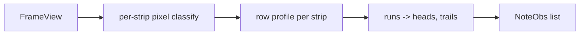

# 03 Detection and calibration

Turns frames into note observations (`NoteObs`) per lane, and finds the lane layout without user input.

> [!warning] No assumptions from reference images
> The images in `docs/research/ff-refs/` are rough examples (old YouTube thumbnails), not what the game looks like. Detection must not take any position, size, colour, shape, background or HUD placement from them. Everything below is learned from the user's own screen during calibration. The only structural facts assumed are: 4 lanes per player, 4 receptors in a straight row with equal spacing, notes move along the lane toward the receptor.

> [!note] Confirmed on the user's screen (M0, 2026-11-21)
> - Our playfield is always the larger group, horizontally centred. The opponent's is a smaller group on the right.
> - Note heads have a different colour per lane (learned per lane, never fixed).
> - Hold trails are a shade of grey in every lane (low chroma; one trail class for all lanes).
> - Idle receptors are grey and light up in the lane colour on press.

- Note and receptor shapes, colours and sizes vary by skin and settings; nothing about them is a constant.
- The playfield background may be dark, busy or animated; the background model must cope with all three.

## Pipeline per frame (scan thread)

### 1. Strips
For lane `i`: centre x = receptor x, width `w = 0.35 * pitch` (min 6 px), from the receptor centre back along the approach direction for `approach_len` (default 70% of the stream height, clipped to the frame). The capture region is the bounding box of the 4 strips plus a 1-radius margin. Opponent strips are not captured.

### 2. Pixel classification
Each pixel gets one of `Bg`, `Head(lane)`, `Trail`, `Other`.
- Convert BGRx to a cheap opponent space: `Y = (r + 2g + b) / 4`, `C1 = r - b`, `C2 = g - (r + b)/2` (integer math).
- `Head(lane)`: distance to the lane's learned head colour (C1, C2, Y) under `head_tol` (adaptive, see below).
- `Trail`: distance to the learned trail colour under `trail_tol`.
- `Bg`: luma within `bg_tol` of the background model: one luma per strip pixel, seeded from the calibration median, updated (alpha 1/8, every 4th frame) only on pixels not classed `Head` or `Trail`.
- `Trail` = learned trail colour within `trail_tol` and not background (luma more than `bg_tol` off the background model). The learner only accepts a trail colour that stands clear of the median background, so this second test only removes background art of the trail's colour.
- Trails need a learned trail colour; until then no trail is reported (a grey rule would match a black background whenever the background model is off).
- Everything else `Other` (receptor glow, splashes, UI).

### 3. Row profile
For each strip row, `fill = matching_pixels / w` per class. A row is "head" if `fill_head >= 0.4`, "trail" if `fill_trail >= 0.4`. (0.5 made sideways arrows bimodal on the user's skin: the triangle's slanted edges sit right at half the strip width, giving runs of 80 or 118 px. At 0.4 every lane gives one length.) 1D, so 900 rows x 4 lanes per frame.

### 4. Runs to observations
- Contiguous head rows form a run. `head_len` is the learned run length of one head in that lane (sideways arrows give shorter runs than up/down ones). Runs shorter than `0.4 * head_len` are noise.
- Runs longer than `1.2 * head_len` are overlapping heads (jacks at low speed): only the two exposed ends are reported, one head from each end. Middle notes appear as the front ones are hit.
- A run cut by the far end of the strip reports one head from its near end if at least `0.9 * head_len` is visible, else nothing.
- Head `y` = sprite centre: fill-weighted centroid of the run minus the receptor's centroid offset (`run_shape`, scaled by `head_len / run_len`). Arrows are not symmetric along the strip, so the raw centroid is not the centre.
- A trail run adjacent to a head (on the far side from the receptor) marks a hold. Its far end is `TrailEnd`. A trail run with no head that touches the receptor zone is a hold in progress: `TrailStart` (near end) and `TrailEnd`. Other trail runs report `TrailEnd` only; the tracker decides. A trail that runs off the far end of the strip reports `TrailCut` instead of `TrailEnd` (its end is not visible yet): the planner keeps such a hold down until the end shows up.
- Notes inside the receptor zone (within one radius of the receptor centre) are still reported. A pressed receptor lights up in the lane colour, so it is also reported as a stationary head at the receptor; the tracker ignores heads that do not move. Trails are not classified inside the zone (the idle receptor is grey too).

## Calibration

Runs in `Searching`, from `FrameSource::snapshot()` at 4 Hz, full frame downscaled 2x.

### Receptor finding
1. Per-pixel "still" luma of 25 snapshots spread over ~6 s, downscaled 2x: for a pixel with grey samples (chroma under 40), the most common grey luma (16 bins); otherwise the median. Idle receptors are grey and do not change, notes are coloured and their outlines move, so in dense charts a receptor uncovered in a few snapshots still shows (a plain median of 9 gave the notes on the user's Maniac jack clip). Mask pixels that differ from the local mean (box radius h/12) by more than 30, then close 2 px gaps per class (outlines of passing notes split receptors). Connected components; keep blobs with bbox area 0.1-5% of frame height squared, fill >= 20% of the bbox, aspect <= 2.
2. Find rows where 4 blobs share a bbox-centre y (within 2% of height), have similar size (sqrt of pixel count within 15%, so rotated arrows match) and equal spacing (pitch deviation under 8%, pitch 0.9-3x the blob size). There may be one or two such groups (one per player); do not assume where on screen they sit.
3. Pick groups greedily by spacing regularity, each blob in one group only.
4. `scroll`: from the sign of note motion once heads move along the strips (tracker, [04](04-timing.md)). Until then, guess from which side of the receptors has more room on screen, and plan no presses until 3 notes confirm the direction.
5. Refine at full resolution on the median of the snapshots: threshold halfway between the 10th and 95th percentile luma of a box around each receptor; the centre is the middle of the thresholded bounding box (the sprite centre). Also store the receptor's run in its strip (`run_len`, and `run_shape` = start, centroid and end relative to the centre) so heads use the same rule.

### Side detection
Which group is ours. In order:
1. Profile's last side if the layout matches within 2% (same monitor and game window).
2. Centre rule (default `side = "centre"`): ours is the largest group, if it is also the group nearest the horizontal centre of the stream. Decides alone when both agree; otherwise step 3.
3. Press correlation (M4, needs input): while `Armed`, our receptors light up when we press. On the first committed presses, compare receptor-zone brightness change of both groups within 60 ms of each press. 3 agreeing presses decide.
4. Ask in the UI (Setup step and a toast on Live).

Receptors do not move between songs on one display. When the profile matches the display and holds a layout and colours, a run skips the receptor search and colour learning and only learns the stage background (median over 1.5 s; the detector keeps adapting it). If no group is found on a full calibration, the saved receptor positions are used. `--relearn` forces both a fresh search and fresh colours.

Until decided, plan presses for neither side; `Armed` waits. In dry run, use the user's own key presses (evdev, if readable) for step 3.

### Colour learning
- Background for learning: per-pixel median luma of ~20 frames spread over the whole learning window (10-20 s). A shorter spread lets one long hold's trail become background.
- Foreground while learning: "saturated or bright, not background" (`|C1| + |C2| > learn_chroma` or luma differs from the background by more than `bg_tol`).
- Heads: foreground runs at the detector's `head_fill`, 0.3-1.6x the receptor size, not cut by the strip ends, clear of the receptor zone and not inside a long (hold) run. A grey run whose luma is within `2 * bg_tol` of the background is animated background and is skipped. Per lane: the head colour is the median of the densest cluster of run colours (trail pieces, glow or background can make a sizeable minority, and a per-channel median of a mixture is no colour at all); `head_tol` = 95th percentile pixel distance of the cluster (clamped); `head_len` = most common run length (+/- 3 px), not the median, which merged jacks drag up. Needs 6 runs per lane (each frame a note is visible counts).
- Trail colour: from foreground runs (at `trail_fill`, so a trail is one run) at least 1.8x the receptor size; only rows whose middle half of the strip is mostly pixels clearly off the background (`2 * bg_tol` or saturated), and only those middle-half pixels (popups and neighbours reach the strip edges, a trail always fills the middle). Pixels matching any head are dropped; colour = median of the densest cluster. Needs 3 such runs and 200 pixels, and must stand clear of the median background (else no trail colour). Shared by all lanes. On the user's skin it learns exactly (85, 85, 85).
- Head colours are learned over a fixed window (the CLI: `--learn`, by recorded time), extended (live, up to 30 s) while any lane has under 6 separate heads: jacks merge into long runs that do not count. Stopping as soon as some counts are reached can end before the first hold.
- Songs can start without holds or have none, so play never waits for the trail colour. Until it is learned, holds are tapped; meanwhile a side thread keeps feeding the learner every 8th frame and hands the trail colour to the detector (and the profile) once 3 holds have been seen.
- If learning fails with the guessed scroll direction, retry the other way (`cli detect` does this).
- Store learned colours in the profile. When the profile matches (display, and receptors within 2% of the stream height), the stored colours are used and only the background is re-learned. Re-learn when a song starts and the stored colours match under 50% of moving blobs (skin change); until the app does this, the CLI takes `--relearn`.

### Manual nudge
Setup > Calibrate shows the snapshot with receptor boxes and strips. Users can drag a box (whole layout moves together) and change pitch and strip width. Saved to the profile as an offset on top of auto-detection.

## Session state (`core::session`)

| From | To | When |
|---|---|---|
| Idle | Searching | Engine started |
| Searching | Armed | A layout is found and our side is known (or the profile side matches) |
| Armed | Playing | First head tracked moving toward our receptors |
| Playing | Results | Receptors not found for 1.5 s, or the results screen template matches |
| Results | Searching | After writing the history row |
| any | Paused | Toggle hotkey or focus lost (focus loss returns to the previous state when regained) |

Receptor presence check while `Armed`/`Playing`: every 10th frame, compare the receptor zone against the receptor template from calibration (NCC over a 2r x 2r box; present if >= 0.6 on 3 of 4 lanes).

## HUD reading (`core::hud`, hud thread, 10-20 Hz)

No OCR. Every element is found and read with a per-profile glyph atlas that is taught from text whose content is known. (The earlier plan used ocrs; it needs model files, which means bundling or a network fetch, and decisions.md keeps OCR for song titles only. Song title reading is deferred.) The module is pure: it takes a `FrameView` and returns typed reads, the hud thread is the integrator's.

| Element | Text (verified on the user's game, G3/G6/G11) | Face | Region found by | Read as |
|---|---|---|---|---|
| Stats panel | 7 left-aligned rows: `Accuracy: 0.00%`, Highest Combo, Combo, Hits, Misses, `Mean MS: 0.00 ms`, KPS | Stats | stack of 7 rows | `StatsRead` (every field `Option`) |
| Judgment counts | 5 rows: Sick, Good, Ok, Bad, Miss (each its own colour) | Stats | stack of 5 rows | `Counts` |
| ms readout | `-143.26 ms`, yellow, under the judgment popup (G4: late is negative) | Ms | reading candidate lines | `f32` as shown |
| Scores | bare signed integer next to each avatar, bottom corners | Score | reading candidate lines | `[left, right]`; the engine maps sides to self/opponent |
| Results panel | "Stats from Last Song": Sick..Miss, Total Notes; Accuracy, Mean MS, Combo, Highest Combo | Results | stacks of 6 and 4 rows, labels verified | `ResultsRead`; counts must add up to Total Notes |
| Judgment popup word | big decorative font, jittery, "MISS MISS" | none | not read | deferred; the counts changing tell which judgment happened |
| Song title, difficulty, time | small text top centre | none | not read | deferred (needs OCR) |

A face is a font style with its own glyph shapes: the stats panel and the counts share one; the ms readout, the scores and the results panel each differ.

### Segmentation and matching
- Brightness is luma, not max channel (a pure red stage glow must stay below the coral Miss text). Text is bright with a dark outline, in any colour.
- A line is a group of bright connected components on one row (gaps up to one text height). Lines are found over the whole frame once per profile (`find_lines`, threshold luma 105 for the game, 90 for the results panel).
- Inside a region: loose threshold (0.45 of the region's 98th percentile) finds column groups, then each group is thresholded at 0.78 of its own plateau (75th percentile of its ink), so a dim magenta label and a white value on one row both survive and touching glyphs split. Column projection gives cells. A cell much wider than a glyph is cut at the emptiest column near equal divisions.
- Every cell is the glyph bounding box resampled (area average) to a 12 x 16 bitmap over the row's common vertical range (median top and bottom of the tall cells), so `.` stays at the bottom and `-` in the middle. Distance = mean absolute difference (0..1) + 0.4 x aspect difference. Up to 6 examples per (face, char) are kept.
- Reject: any glyph above `glyph_max_sad` (profile `[detect]`, default 0.25), a near tie between two different characters (3 against 5), or a failed parse. Parsing is per element (`parse_ms`: signed `n.nn` then `ms`; `parse_pct`: `n.nn%`, 0-100; unsigned and signed integers; the judgment words).
- A cell that matches nothing may hold two touching glyphs (a `.` against a digit): the reader tries every cut and accepts the best pair that both match.
- Row labels (`Accuracy:`, `Sick:`...) are matched as whole-word bitmaps (48 x 16). The label ends at the Nth wide gap (N = words in the label); the value is what follows. A row that does not match its label is not read, so an occluded row (a hold trail across the counts) gives `None` for that row only.
- Rows of a stack are found by row projection; columns with an unbroken ink run longer than one row pitch (a hold trail) are ignored, and if rows still merge they are laid out from the stack's even pitch.

### Finding the regions (no OCR)
1. Stats and counts: text lines that form a stack of 7 (5) left-aligned rows of similar height and regular pitch. Once labels are taught the first rows are verified against them.
2. ms readout: of the remaining lines (and unions of neighbouring pieces, since the ms font is wide-spaced), the first one that reads as a valid `ms` string with the Ms face.
3. Scores: remaining lines that read as integers with the Score face; the two tallest, split left and right by the frame middle. An avatar touching the number is dropped by its poor match, and the stored rect hugs the digits.
4. Results: a stack of 6 and a stack of 4 whose labels match with the Results face.
Regions go to the profile's `[hud]` ([08](08-config.md)). Missing elements disable what needs them; nothing else breaks.

### Teaching the atlas (bootstrap)
Glyph shapes cannot be known before the game has been seen, so the atlas is taught from text the app knows:
1. Song start (session `Armed`, before the first hit): every counter reads zero. `bootstrap_song_start` teaches `Accuracy: 0.00%`, the zeros, `Mean MS: 0.00 ms`, and the five count rows from that fact alone. This gives `0 . % m s` and all row labels, no OCR.
2. Digits 1-9: `teach_stack(layout, values)` with the value the counter must have. The runner calls it as Combo, Hits and the counts tick up (`previous + 1`), so the atlas fills during the first notes. Unlabelled cells never enter the atlas.
3. Setup shows the stats and counts rows and the ms and score lines with their reads and lets the user type the real value to correct or add a glyph (`teach_stack`, `teach_lines`). `teach_lines` takes an optional search rect, because the HUD has sprites that look like text.
4. The ms and score faces are taught the same way when a value is known: after each hit the counts change, and the ms readout's expected digits are confirmed in Setup. Until a face is taught, its elements read `None`.
5. `cli hud <png...> --teach 'file.png:kind=values'` runs this on screenshots (kinds: `stats`, `counts`, `rstats`, `rcounts`, `ms`, `score`) and prints regions and reads. The atlas can be saved with `--atlas f.bin --save`.
`glyphs/<profile>.bin`: magic `AHGL`, version 1, then glyphs (face, char, aspect, 192 bytes) and words (face, name, cell count, aspect, 768 bytes); written atomically. A missing or unreadable file is an empty atlas.

> [!note] Results on the user's 2560x1440 screenshots (v0.2)
> Taught on game2-5 (stats, counts, ms, scores) and read on the rest: held-out game6 reads misses 652, ms -141.65, scores -19543 / 63082; game1 reads 15 misses, no ms (none on screen), scores -395 / 0. Locate is about 35 ms in release (once per profile), a read about 1 ms.
> - A hold trail crossing the counts (game6) makes the Sick and Good rows unreadable at times; those rows are `None`, the others still read.
> - Results panel: counts, total, combos and mean ms read exactly on the taught screens. On a held-out screen after teaching from two others, counts and Total Notes were right, `Good`/`Bad` rows were rejected, and Accuracy misread `84.93%` as `84.95%`. Two teaching frames are too few for the results face; the live app teaches digits for a whole song. Do not trust results Accuracy until the face has seen many examples.
> - The final score on the results panel is not read yet.

## Performance budget
Per frame on the scan thread at 240 Hz (4.2 ms period): classify + profile + runs for 4 strips of 50 x 900 px = 180k pixels. Target `< 0.6 ms` p99 scalar on the dev machine. If not met: row-skip classification (classify every 2nd row, refine only near runs) before any SIMD.

Measured (M3, dev machine, release, `cli detect` on a 12 s clip of the user's game): strips are 78 x ~1100 px x 4 = 343k pixels at 2560x1440, p50 0.94 ms, p99 1.12 ms. That is inside the 6 ms period at 165 Hz, so row-skip is not done yet; do it before targeting 240 Hz.

## Configuration (profile `[detect]`)
`strip_width_frac = 0.35`, `approach_len_frac = 0.70`, `head_fill = 0.4`, `trail_fill = 0.4`, `head_tol_min/max = 12/60`, `trail_tol_min/max = 12/40`, `bg_tol = 18`, `learn_chroma = 40`, `receptor_ncc_min = 0.6`, `glyph_max_sad = 0.25` (HUD, mean absolute difference per glyph cell).

## Acceptance (M3)
- `arrowhead-cli detect <clip>` prints layout, side, scroll and a per-frame list of observations; an annotated PNG per N frames with `--debug-png`.
- On synthetic frames ([09](09-testing.md)): layout found within 1 px; zero missed heads and zero false heads over 10k notes at scroll speeds 1.0-4.0 and both directions, including jacks at 50 ms spacing and holds.
- On M0 recorded clips: every labelled note gets observations in at least 3 frames before its crossing.

> [!note] M3 results (2026-11-21)
> - Synthetic (`core/src/detect/synth_tests.rs`): calibration within 1 px at 1280x720, 1920x1080 and 2560x1440, both directions. Detection over 10,073 notes (8 suites: up/down x 0.4, 1, 2, 3 px/ms at 60 fps, random shapes, colours and backgrounds, glow, popup, 1 ms jitter, 2% drops): 0 missed heads, 0 false heads, 0 missed trail ends, every note seen in 3+ frames. "Missed" counts heads fully inside the strip that are exposed (not covered on both sides by other heads) and not in a lit receptor; a head or trail end matches within 2 px.
> - User's game (`song-01.mkv`, 12 s from 85 s, region 760,0,1040,1440): one group found, pitch 224.3, size 147, upscroll guessed and confirmed by motion (4307 up / 15 down votes), trail learned as (85, 85, 85). No labels yet, so the check was by linking observations into tracks: every note track starts at the far end of the strip and gets 30-88 observations before it is hit. Gaps: the judgment popup ("GOOD!") briefly hides notes in lanes 1-2 (a few frames), and a lit receptor is reported as a stationary head; both are for the M4 tracker.
> - Real-clip labels (`cli label`) and the press-correlation side step move to M4.

## Known limits (M3/M4)
- Middle notes of 3+ note jacks whose heads overlap (50 ms jacks below ~2.5 px/ms at 720p; at the user's 1.9 px/ms at 1440p a 50 ms jack overlaps, a 100 ms one does not) are not visible on their own until the notes in front are hit; the lit receptor can then merge with them too. They are reported as missed by the M4 replay test (`hidden_unpressed`). Splitting on the near note's outline needs real footage of such a jack.
- A static saturated background (for example pure blue) passes the learning foreground rule by chroma alone; the learner then finds no head-sized runs. The background model is luma only.
- `cli detect` on a clip recorded with a region that cuts through a strip skips that lane while learning.
- A receptor box clipped by the screen edge can give a flat presence template (NCC 0).
- Profiles never stored colours before M4, so a `[colours]` table without `head_len` is not handled.
