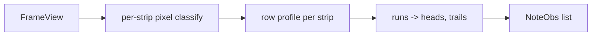

# 03 Detection and calibration

Turns frames into note observations (`NoteObs`) per lane, and finds the lane layout without user input.

> [!warning] No assumptions from reference images
> The images in `docs/research/ff-refs/` are rough examples (old YouTube thumbnails), not what the game looks like. Detection must not take any position, size, colour, shape, background or HUD placement from them. Everything below is learned from the user's own screen during calibration. The only structural facts assumed are: 4 lanes per player, 4 receptors in a straight row with equal spacing, notes move along the lane toward the receptor.

- Note and receptor shapes, colours and sizes vary by skin and settings; nothing about them is a constant.
- The playfield background may be dark, busy or animated; the background model must cope with all three.

## Pipeline per frame (scan thread)

### 1. Strips
For lane `i`: centre x = receptor x, width `w = 0.35 * pitch` (min 6 px), from the receptor centre back along the approach direction for `approach_len` (default 70% of the stream height, clipped to the frame). The capture region is the bounding box of the 4 strips plus a 1-radius margin. Opponent strips are not captured.

### 2. Pixel classification
Each pixel gets one of `Bg`, `Head(lane)`, `Trail`, `Other`.
- Convert BGRx to a cheap opponent space: `Y = (r + 2g + b) / 4`, `C1 = r - b`, `C2 = g - (r + b)/2` (integer math).
- `Head(lane)`: distance to the lane's learned head colour (C1, C2, Y) under `head_tol` (adaptive, see below).
- `Trail`: distance to the learned trail colour under `trail_tol`.
- `Bg`: luma within `bg_tol` of the background model for that row (running median per strip row, updated only on rows with no detections, alpha 0.02).
- Everything else `Other` (receptor glow, splashes, UI).

### 3. Row profile
For each strip row, `fill = matching_pixels / w` per class. A row is "head" if `fill_head >= 0.5`, "trail" if `fill_trail >= 0.4`. 1D, so 900 rows x 4 lanes per frame.

### 4. Runs to observations
- Contiguous head rows form a run. Runs shorter than `0.4 * head_diameter` are noise. Runs longer than `1.6 * head_diameter` are split at local minima of fill (two notes touching at high speed or jacks).
- Head `y` = fill-weighted centroid of the run (sub-pixel).
- A trail run adjacent to a head (on the far side from the receptor) marks a hold. Its far end is `TrailEnd`. A trail run with no head that touches the receptor is a hold in progress.
- Notes inside the receptor zone (within 0.6 radius of the receptor centre) are still reported; the receptor glow is classed `Other` and does not mask them because the head colour is learned separately.

## Calibration

Runs in `Searching`, from `FrameSource::snapshot()` at 4 Hz, full frame downscaled 2x.

### Receptor finding
1. Edge and brightness map; candidate blobs of any shape, size bounds wide and configurable (`receptor_area_min/max`, defaults 0.1-5% of frame height squared).
2. Find rows where 4 candidates share a y (within 2% of height), have similar size (within 15%) and equal spacing (pitch deviation under 8%). There may be one or two such groups (one per player); do not assume where on screen they sit.
3. Prefer groups that stay still across snapshots while other things move (receptors are fixed; notes and backgrounds are not). Score by stillness, shape similarity across the four, and contrast to the surround.
4. `scroll`: from the sign of note motion once heads move along the strips (tracker, [04](04-timing.md)). Until then, guess from which side of the receptors has more room on screen, and plan no presses until 3 notes confirm the direction.
5. Refine each receptor centre to sub-pixel by the centroid of its outline at full resolution.

### Side detection
Which group is ours. In order:
1. Profile's last side if the layout matches within 2% (same monitor and game window).
2. Press correlation: while `Armed`, our receptors light up when we press. On the first committed presses, compare receptor-zone brightness change of both groups within 60 ms of each press. 3 agreeing presses decide.
3. Ask in the UI (Setup step and a toast on Live).

Until decided, plan presses for neither side; `Armed` waits. In dry run, use the user's own key presses (evdev, if readable) for step 2.

### Colour learning
- Heads: for each lane, collect pixels of the first 6 confirmed head runs (moving, right size, right lane); take the median (C1, C2, Y) and the 95th percentile distance as `head_tol` (clamped to config min/max). Before learning finishes, use a permissive "saturated or bright, not background" rule to find heads.
- Trail colour: same, from runs behind heads that persist across 3+ frames. v2's grey (85, 85, 85) is the initial guess only.
- Store learned colours in the profile. Re-learn when a song starts and the stored colours match under 50% of moving blobs (skin change).

### Manual nudge
Setup > Calibrate shows the snapshot with receptor boxes and strips. Users can drag a box (whole layout moves together) and change pitch and strip width. Saved to the profile as an offset on top of auto-detection.

## Session state (`core::session`)

| From | To | When |
|---|---|---|
| Idle | Searching | Engine started |
| Searching | Armed | A layout is found and our side is known (or the profile side matches) |
| Armed | Playing | First head tracked moving toward our receptors |
| Playing | Results | Receptors not found for 1.5 s, or the results screen template matches |
| Results | Searching | After writing the history row |
| any | Paused | Toggle hotkey or focus lost (focus loss returns to the previous state when regained) |

Receptor presence check while `Armed`/`Playing`: every 10th frame, compare the receptor zone against the receptor template from calibration (NCC over a 2r x 2r box; present if >= 0.6 on 3 of 4 lanes).

## HUD reading (`core::hud`, hud thread, 10-20 Hz)

Which elements exist, where they are and how they look is unknown until M0. Each element's region is found by searching the whole frame (ocrs, off the hot path) for its text pattern, then stored in the profile. Missing elements disable the features that need them; nothing else breaks.

| Element | Expected text pattern (verify in M0) | Method | Used for |
|---|---|---|---|
| ms readout | signed number + "ms" | Glyph templates | Timing readback ([04](04-timing.md#readback)) |
| Judgment word | Sick / Good / Ok / Bad / Miss | Template per word | Readback, history |
| Accuracy | number + "%" | Glyph templates | Controller ([06](06-humanizer.md)), history |
| Scores (ours, opponent's) | "Score" + integer | Glyph templates | Match mode |
| Song title + difficulty | free text | ocrs, once per song | History |

### Glyph templates
- Atlas per profile (font size depends on resolution): digits 0-9, `.`, `-`, `%`, `:`, plus the words Sick, Good, Ok, Bad, Miss.
- Bootstrap: on the first frames where a HUD region is stable for 300 ms, run ocrs on it (off the hot path), segment by column projection, label glyphs from the OCR text, keep the cleanest example per glyph. The user can confirm the atlas in Setup.
- Reading: threshold by the white text with dark outline, column projection to split glyphs, nearest template by SAD on a normalised 12 x 16 cell. Reject the read if any glyph's best SAD is above `glyph_max_sad` or the parse fails the expected pattern (regex per element).
- Regions for each element are found once per profile by searching for the pattern text with ocrs, then fixed.

## Performance budget
Per frame on the scan thread at 240 Hz (4.2 ms period): classify + profile + runs for 4 strips of 50 x 900 px = 180k pixels. Target `< 0.6 ms` p99 scalar on the dev machine. If not met: row-skip classification (classify every 2nd row, refine only near runs) before any SIMD.

## Configuration (profile `[detect]`)
`strip_width_frac = 0.35`, `approach_len_frac = 0.70`, `head_fill = 0.5`, `trail_fill = 0.4`, `head_tol_min/max`, `trail_tol_min/max`, `bg_tol = 18`, `receptor_ncc_min = 0.6`, `glyph_max_sad`.

## Acceptance (M3)
- `arrowhead-cli detect <clip>` prints layout, side, scroll and a per-frame list of observations; an annotated PNG per N frames with `--debug-png`.
- On synthetic frames ([09](09-testing.md)): layout found within 1 px; zero missed heads and zero false heads over 10k notes at scroll speeds 1.0-4.0 and both directions, including jacks at 50 ms spacing and holds.
- On M0 recorded clips: every labelled note gets observations in at least 3 frames before its crossing.
